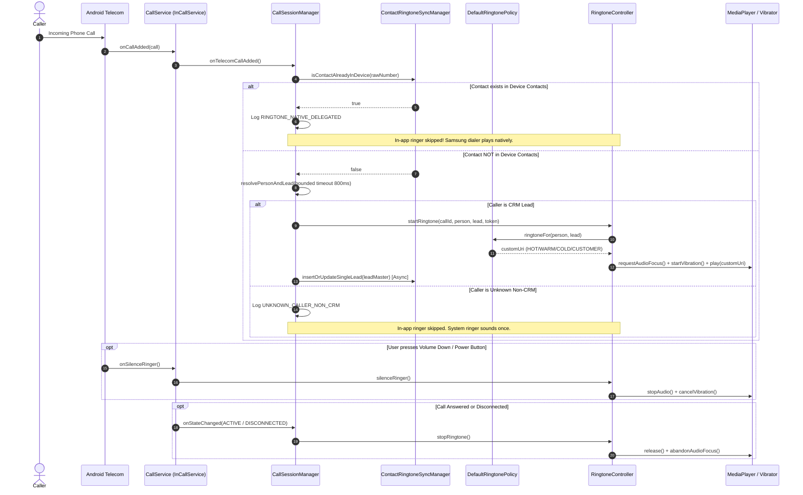

# CRM Custom Ringtone & Audio Architecture Specification

## 1. Executive Summary & Problem Statement

In modern enterprise mobile applications, sales and CRM professionals need immediate auditory and tactile awareness of who is calling. A high-intent lead (HOT) demands an urgent ringtone and distinctive double-pulse vibration, an active enterprise client (CUSTOMER / VIP) requires a premium tone, whereas cold outreach or regular contacts should use a subtle chime or standard ringtone.

However, implementing custom contact- and status-based ringtones on modern Android (especially on OEM devices such as **Samsung One UI**, **Xiaomi MIUI**, or **Google Pixel**) presents major system architecture challenges:

1. **The Dual-Ringing Audio Collision**:
   When declaring Android Telecom's `<meta-data android:name="android.telecom.IN_CALL_SERVICE_RINGING" android:value="true" />`, an app's `InCallService` is given permission to manage ringtone audio. However, OEM system dialers (notably Samsung's InCallUI) often ring simultaneously using system telephony events. If an app plays audio via `MediaPlayer` while Samsung's dialer also rings, **two different ringtones play at the same time in an asynchronous race condition**.
2. **Scoped Storage & Cross-UID IPC Permission Denials**:
   System phone dialers run under separate system process UIDs (e.g., `com.samsung.android.incallui` or `com.android.phone`). If an app saves custom audio to private internal storage (`context.filesDir/ringtones/`), setting that private URI to `ContactsContract.Contacts.CUSTOM_RINGTONE` causes the system dialer to crash or fail with a `SecurityException: Permission Denial` because it cannot read another application's private sandbox.
3. **Transient Audio Focus & Ringer State Transitions**:
   Calls can arrive while the user is listening to music, navigating with GPS instructions, or when the phone is flipped face-down to silence. The ringtone engine must handle ringer modes (`NORMAL`, `VIBRATE`, `SILENT`), hardware key silencing (volume down / power button), transient focus ducking, and immediate teardown upon call answer, reject, or disconnect.

Callog / AllSet CRM solves these problems through a **Two-Pronged Hybrid Architecture** combining **Native MediaStore Export + ContactsContract Injection** with **Dynamic In-App Telecom InCallService Ringing**.

---

## 2. High-Level System Architecture

```text
                                 ┌─────────────────────────────────┐
                                 │   Incoming Call Triggered       │
                                 │   (Telecom CallService)         │
                                 └────────────────┬────────────────┘
                                                  │
                                                  ▼
                                 ┌─────────────────────────────────┐
                                 │   CallSessionManager.kt         │
                                 │   • Query PhoneLookup           │
                                 │   • CRM Person & Lead Lookup    │
                                 └────────────────┬────────────────┘
                                                  │
                                                  ▼
                              Is Contact Already in Device Address Book?
                                              /       \
                                            /           \
                                      YES /               \ NO
                                        /                   \
                                       ▼                     ▼
             ┌───────────────────────────────────┐    ┌───────────────────────────────────┐
             │      STRATEGY A: NATIVE OEM       │    │     STRATEGY B: IN-APP TELECOM    │
             │   (Delegated to System Dialer)    │    │       (RingtoneController)        │
             ├───────────────────────────────────┤    ├───────────────────────────────────┤
             │ • In-app audio is SUPPRESSED      │    │ • RingtonePolicy resolves URI     │
             │ • Samsung InCallUI reads          │    │ • Audio Focus requested           │
             │   ContactsContract.CUSTOM_RINGTONE│    │ • Lead-aware haptic pulse triggered│
             │ • Audio plays natively via        │    │ • MediaPlayer loops custom audio  │
             │   public MediaStore content URI   │    │ • Suppresses if non-CRM unknown   │
             │ • ZERO dual-ringing race condition│    │ • Asynchronously syncs lead into  │
             │                                   │    │   device contacts for future calls│
             └───────────────────────────────────┘    └───────────────────────────────────┘
```

---

## 3. Component Deep Dive

### 3.1. `ContactRingtoneSyncManager` & `MediaStoreRingtoneExporter` (Strategy A)

Located in:
- [`data/provider/ContactRingtoneSyncManager.kt`](file:///D:/repo/app/src/main/java/com/example/callog/data/provider/ContactRingtoneSyncManager.kt)
- [`data/telecom/MediaStoreRingtoneExporter.kt`](file:///D:/repo/app/src/main/java/com/example/callog/data/telecom/MediaStoreRingtoneExporter.kt)

#### The MediaStore Bridge
To grant the separate system UID of Samsung InCallUI access to our CRM ringtones without permission errors, `MediaStoreRingtoneExporter`:
1. Reads the configured audio file from app storage or cache.
2. Checks whether a public `MediaStore.Audio.Media` entry with title `"Callog CRM <Status>"` already exists.
3. If not present, inserts a public record into `MediaStore.Audio.Media.EXTERNAL_CONTENT_URI` (or `MediaStore.VOLUME_EXTERNAL_PRIMARY` on Android 10+ / API 29+ under `Ringtones/Callog`).
4. Sets standard Android audio flags:
   - `IS_RINGTONE = 1`
   - `IS_NOTIFICATION = 0`
   - `IS_ALARM = 0`
   - `IS_MUSIC = 0`
   - `IS_PENDING = 0` (upon completion of byte stream copy).
5. Returns a publicly resolvable `content://media/external/audio/media/<id>` URI.

#### Native ContactsContract Injection
`ContactRingtoneSyncManager` interacts with Android's system contacts provider:
- **`isContactAlreadyInDevice(phoneNumber)`**: A sub-5ms query on `ContactsContract.PhoneLookup.CONTENT_FILTER_URI` using projection `[_ID]`.
- **`syncAllLeadsToContacts(leads)`**: Batch syncs all CRM leads. For existing contacts, updates `ContactsContract.Contacts.CUSTOM_RINGTONE`. For new leads, creates a `RawContact` with account type `com.example.callog` and sets `CUSTOM_RINGTONE`, structured name, and phone number in an atomic batch operation (`applyBatch`).
- **`insertOrUpdateSingleLead(lead)`**: An on-demand asynchronous fallback triggered during incoming calls from previously unsynced CRM leads.

---

### 3.2. `RingtoneController` & `DefaultRingtonePolicy` (Strategy B)

Located in:
- [`core/telecom/RingtoneController.kt`](file:///D:/repo/app/src/main/java/com/example/callog/core/telecom/RingtoneController.kt)
- [`core/telecom/CallRingtoneManager.kt`](file:///D:/repo/app/src/main/java/com/example/callog/core/telecom/CallRingtoneManager.kt)
- [`data/telecom/DefaultRingtonePolicy.kt`](file:///D:/repo/app/src/main/java/com/example/callog/data/telecom/DefaultRingtonePolicy.kt)
- [`domain/repository/RingtonePolicy.kt`](file:///D:/repo/app/src/main/java/com/example/callog/domain/repository/RingtonePolicy.kt)

When an incoming call is received for an unsynced lead or where in-app playback is authoritative:
1. **Telecom State Interception**: `CallService.onCallAdded()` signals `CallSessionManager`.
2. **Bounded CRM Lookup**: `CallSessionManager` launches a coroutine with a strict timeout (`CRM_LOOKUP_TIMEOUT_MS = 800ms`) querying `personRepository.findPersonByNormalizedPhone()` and `leadRepository.getLeadForPerson()`.
3. **Dual-Ring Suppression**:
   - If `contactRingtoneSyncManager.isContactAlreadyInDevice(rawNumber)` is `true`, `CallSessionManager` **does not** start in-app audio, logging `RINGTONE_NATIVE_DELEGATED`.
   - If the caller is an unknown non-CRM caller (`leadMasterEntity == null`), in-app audio is **suppressed** (`UNKNOWN_CALLER_NON_CRM`), delegating to the native system ringtone.
4. **Idempotency & Generation Tokens**:
   - `RingtoneController` maintains an atomic `currentGenerationToken`. Any new call state or cancellation increments the token, immediately invalidating delayed or stale asynchronous lookup callbacks.
   - If `startRingtone()` is called repeatedly for the same call ID and same resolved URI while already playing, it ignores redundant invocations (`RINGTONE_ALREADY_PLAYING`).

---

## 4. Strict 5-Tier Ringtone Resolution Hierarchy

Resolution order enforced by [`DefaultRingtonePolicy`](file:///D:/repo/app/src/main/java/com/example/callog/data/telecom/DefaultRingtonePolicy.kt) and [`CallRingtoneManager`](file:///D:/repo/app/src/main/java/com/example/callog/data/telecom/CallRingtoneManager.kt):

| Priority | Level | Condition | Fallback / Behavior |
|:---:|---|---|---|
| **1** | **Person-Specific** | User has assigned a custom ringtone directly to `person.id` via Contact Profile or API (`ringtone_person_<personId>`). | Highest precedence. Overrides all lead statuses. |
| **2** | **CRM Priority** | Lead has priority `LeadPriority.URGENT` or `LeadPriority.HIGH`. | Triggers urgent CRM tone (`ringtone_crm_priority`). |
| **3** | **Lead Status** | Lead status is explicitly `HOT`, `WARM`, `COLD`, or `NEW`. | Resolves status tone (`ringtone_lead_hot`, `ringtone_lead_warm`, `ringtone_lead_cold`, `ringtone_lead_new`). |
| **4** | **Customer / VIP** | Lead status is `CUSTOMER`, lead notes/feedback contain `"Customer"`, or `person.companyName` is not blank. | Resolves Customer VIP tone (`ringtone_customer_type`). |
| **5** | **System Default** | Unknown caller, unconfigured lead status, or corrupted tone. | Falls back to `RingtoneManager.getDefaultUri(TYPE_RINGTONE)` or `TYPE_NOTIFICATION`. |

---

## 5. Lead-Aware Haptic Feedback Engine

Haptic profiles are generated via Android's `Vibrator` / `VibratorManager` using waveform timings tailored to sales urgency:

```text
HOT Lead (Double Pulse):
  Vibrate (250ms) ── Pause (150ms) ── Vibrate (250ms) ──────── Gap (1000ms) ── [Loop]

WARM Lead (Standard Alert):
  Vibrate (1000ms) ─────────────────────────────────────────── Gap (1000ms) ── [Loop]

COLD Lead (Subtle Chime):
  Vibrate (150ms) ──────────────────────────────────────────── Gap (2500ms) ── [Loop]

DEFAULT / Unknown:
  Vibrate (1000ms) ─────────────────────────────────────────── Gap (1000ms) ── [Loop]
```

### Haptic Waveform Patterns
- **HOT**: `longArrayOf(0, 250, 150, 250, 1000)` (Index 0 loop).
- **WARM**: `longArrayOf(0, 1000, 1000)`.
- **COLD**: `longArrayOf(0, 150, 2500)`.
- **Call Connected**: Tactile click (`VibrationEffect.EFFECT_CLICK`).
- **Call Ended**: Double tick (`VibrationEffect.EFFECT_DOUBLE_CLICK`).

---

## 6. Audio Focus, Ringer Modes & Hardware Controls

### 6.1. Device Ringer Mode Enforcement
Before any audio or vibration starts, `RingtoneController` queries `AudioManager.ringerMode`:
- `AudioManager.RINGER_MODE_SILENT`: Both audio playback and haptics are strictly aborted.
- `AudioManager.RINGER_MODE_VIBRATE`: Audio playback is suppressed; haptic vibration plays.
- `AudioManager.RINGER_MODE_NORMAL`: Both audio and haptics play according to policy.

### 6.2. Hardware Kill-Switch
If the user accepts the call on a lockscreen notification or external OEM heads-up display before `RingtoneController` finishes initializing, `audioManager.mode` will already transition to `MODE_IN_CALL` or `MODE_IN_COMMUNICATION`. The controller checks this immediately and halts playback to prevent ringing in the user's ear.

### 6.3. Audio Focus Lifecycle
- **Request**: Requests `AUDIOFOCUS_GAIN_TRANSIENT_MAY_DUCK` with `USAGE_NOTIFICATION_RINGTONE` and `CONTENT_TYPE_SONIFICATION`.
- **`AUDIOFOCUS_LOSS`**: Permanently stops ringtone and releases player.
- **`AUDIOFOCUS_LOSS_TRANSIENT`**: Pauses player temporarily; resumes when focus returns.
- **`AUDIOFOCUS_LOSS_TRANSIENT_CAN_DUCK`**: Ducks volume to 20% (`setVolume(0.2f, 0.2f)`).
- **`AUDIOFOCUS_GAIN`**: Restores volume to 100% and unpauses if previously paused.
- **Teardown**: Calls `abandonAudioFocus()` and clears references.

### 6.4. User Hardware Silencing (`onSilenceRinger`)
When the user presses the hardware volume rocker or power button during an incoming call:
1. Android Telecom invokes `CallService.onSilenceRinger()`.
2. `CallService` dispatches to `ringtoneController.silenceRinger()` and `callSessionManager.silenceRinger()`.
3. Sets `isSilencedByUser = true`, stops `MediaPlayer`, and cancels vibration **without hanging up or disconnecting the call**.

---

## 7. Storage Atomicity & Fault Tolerance (`RingtoneRepositoryImpl`)

Located in [`data/repository/RingtoneRepositoryImpl.kt`](file:///D:/repo/app/src/main/java/com/example/callog/data/repository/RingtoneRepositoryImpl.kt).

### 7.1. Private App Sandbox
Custom ringtone files are stored in `context.filesDir/ringtones/`:
- Format: `<targetKey>.audio` (e.g., `ringtone_lead_hot.audio`, `ringtone_person_P001.audio`).
- Persisted URI format: `file:///data/user/0/com.example.callog/files/ringtones/ringtone_lead_hot.audio`.

### 7.2. Two-Stage Atomic Import
When a user selects an audio track via system picker or content URI:
1. Stream bytes from content resolver into a timestamped temp file: `<targetKey>_tmp_<timestamp>.tmp`.
2. Validate the imported file:
   - Ensure `bytesCopied > 0` and file length > 0.
   - Run `MediaMetadataRetriever.setDataSource()` to verify valid audio format (or length > 128 bytes fallback).
3. If valid, atomically replace destination:
   - Delete existing `<targetKey>.audio`.
   - Rename `tempFile` &rarr; `destFile` (or fallback copy).
4. Persist internal URI and friendly display title to `SharedPreferences` (`ringtone_settings_prefs`).
5. If any exception occurs, clean up the temp file and leave previous ringtones intact.

### 7.3. Self-Healing Stale Reference Recovery
If a user cleans app cache or an external tool deletes an imported `.audio` file:
- `getUriFromPref(key)` verifies `file.exists() && file.isFile && file.length() > 0 && file.canRead()`.
- If missing or zero bytes, it automatically removes the preference key and title (`RINGTONE_FILE_CORRUPTED`), returning `null`.
- The system then falls back cleanly to system default without crashing.

---

## 8. Sequence Diagrams

### 8.1. Incoming Call Ringtone Resolution



---

## 9. UI Configuration Workflow

Located in [`presentation/screens/settings/CrmRingtoneSettingsScreen.kt`](file:///D:/repo/app/src/main/java/com/example/callog/presentation/screens/settings/CrmRingtoneSettingsScreen.kt).

- **Route**: `Nav3Key.Settings.CrmRingtoneSettings` accessible via **Settings &rarr; Ringtone Policy**.
- **Interactive Cards**:
  - Hot Lead Ringtone (`Icons.Default.LocalFireDepartment`, red accent `#E85C5C`).
  - Warm Lead Ringtone (`Icons.Default.Bolt`, amber accent `#F4B544`).
  - Cold Lead Ringtone (`Icons.Default.AcUnit`, indigo accent `#4A4FD8`).
  - Customer / VIP Ringtone (`Icons.Default.WorkspacePremium`, emerald accent `#45C79A`).
  - System Default Ringtone (`Icons.Default.NotificationsActive`, slate accent `#94A3B8`).
- **Features**:
  - In-app playback preview with animated play/pause states.
  - Native `RingtoneManager.ACTION_RINGTONE_PICKER` integration with support for system sounds and custom storage audio files.
  - Title resolution extracting user-friendly file or track titles.
  - Reset to default with physical file deletion.
